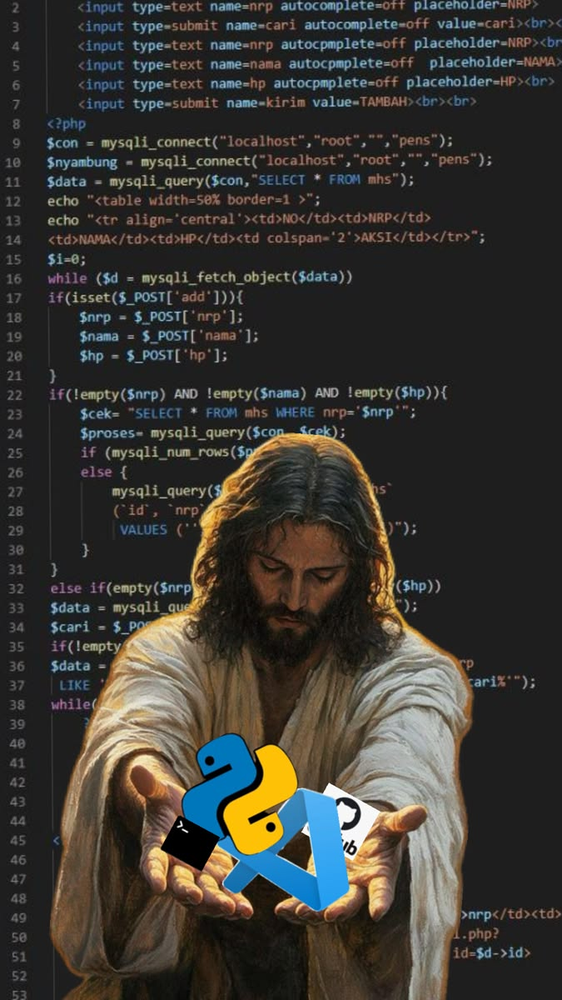

<div align="center">



<a href="https://github.com/Hussaincodes01"></a>

<a href="https://jhussain7.vercel.app/"></a>
<a href="https://www.linkedin.com/in/jiyad-hussain-50379134b/"></a>
<a href="https://www.kaggle.com/hussaincodes01"></a>
<a href="mailto:talk2hussain@gmail.com"></a>

<br/><br/>

<table>
  <tr>
    <td valign="middle" width="50%"></td>
    <td valign="middle" width="50%"></td>
  </tr>
</table>

</div>

## ⟡ &nbsp;About

I'm a Computer Science undergrad at Amity University who builds AI systems end to end, from curating raw data to running inference on real hardware. Most of my work sits where **computer vision meets the physical world**: satellites, lunar orbiters, factory floors and microcontrollers.

```yaml
now:       growing VayuNetra into a satellite + drone + ESP32-sensor network for air monitoring
research:  tri-modal sensor fusion · lightweight segmentation · liquid neural networks
seeking:   remote AI engineering / AI research internships
off-duty:  cooking, football, video games
```

## ⟡ &nbsp;Shipped & Live

<table>
  <tr>
    <td width="50%" valign="top">
      <h3>🛰️ <a href="https://vayunetra-india.vercel.app/">VayuNetra</a></h3>
      <sub>Satellite AI for landfill methane</sub><br/><br/>
      Finds, verifies and quantifies methane plumes over Indian landfills from free Sentinel-2 imagery, then turns each detection into an action dossier for municipal bodies.<br/><br/>
      <b>0.76 ROC AUC</b> vs 0.51 for the MBMP baseline · <b>0 false alarms</b> on 334 control scenes · field-tested on 5 landfills, 674 scenes<br/><br/>
      <code>PyTorch</code> <code>U-Net</code> <code>Sentinel-2</code> <code>Earth Engine</code> <code>Next.js</code><br/>
      <a href="https://vayunetra-india.vercel.app/">Live</a> · <a href="https://github.com/Hussaincodes01/VaayuNetra">Code</a>
    </td>
    <td width="50%" valign="top">
      <h3>🎬 <a href="https://arcvisual.vercel.app">ArcVisual</a></h3>
      <sub>arXiv paper → animated explainer</sub><br/><br/>
      Paste an arXiv link and get a scrollytelling article where the hard ideas are carried by generated Manim animations. Every scene passes security, render and layout checks (legibility, contrast, dead air) before it ships.<br/><br/>
      <b>4-stage pipeline</b>: ingest → analyze → generate → validate, all sharing one storyboard<br/><br/>
      <code>Python</code> <code>Manim</code> <code>FastAPI</code> <code>Next.js</code> <code>PostgreSQL</code><br/>
      <a href="https://arcvisual.vercel.app">Live</a> · <a href="https://github.com/Hussaincodes01/Arcvisual">Code</a>
    </td>
  </tr>
  <tr>
    <td width="50%" valign="top">
      <h3>🌕 <a href="https://github.com/Hussaincodes01/PanjikaV2">Panjika</a></h3>
      <sub>Lunar image registration for ISRO · SIH 2026, PS 26166</sub><br/><br/>
      Matches Chandrayaan-2 and LRO images taken under different sun angles, scales and sensors, where shadows flip as the light moves. Ground truth comes straight from PDS4 metadata labels.<br/><br/>
      <b>73% convergence</b> · <b>1.10 px</b> median error on held-out pairs<br/><br/>
      <code>PyTorch</code> <code>RoMa</code> <code>Computer Vision</code> <code>PDS4</code><br/>
      <a href="https://github.com/Hussaincodes01/PanjikaV2">Code</a>
    </td>
    <td width="50%" valign="top">
      <h3>🎙️ ChotiVaani</h3>
      <sub>Personal wake word on an ESP32</sub><br/><br/>
      Single-speaker keyword spotting that runs fully on-device. Enrol any new wake word from about 10 recordings; it ignores other speakers and doesn't fire when the word shows up mid-sentence.<br/><br/>
      <b>&lt;200 KB</b> memory · <b>&lt;7%</b> dual-core CPU at idle · INT8<br/><br/>
      <code>TensorFlow</code> <code>TFLite Micro</code> <code>ONNX</code> <code>ESP32</code>
    </td>
  </tr>
</table>

## ⟡ &nbsp;Research

| | Work | Status |
|:--:|:--|:--|
| 🔬 | **Tri-Modal PCB Defect Detection** — YOLOv5 with separate RGB, depth and illumination encoders fused by cross-attention, so glare and shadow stop hiding defects. [`code`](https://github.com/Hussaincodes01/Yolo-3D-model-Code) | Conference paper in progress |
| 🛣️ | **CrackSegLite** — a sub-2M-parameter road crack segmentation network with attention-gated, boundary-aware modules and CARAFE upsampling for thin cracks. | IEEE paper |
| 🧠 | **Liquid Neural Networks for Emotion Recognition** — asynchronous audio-visual fusion with CfC networks on RAVDESS, letting each modality keep its own sampling rate. | Targeting ESANN 2027 |

## ⟡ &nbsp;Wins

<table>
  <tr>
    <td align="center" width="20%"><h3>🏆</h3><b>Winner</b><br/><sub>Punjab &amp; Sind Bank Hackathon 2026 — <a href="https://github.com/Hussaincodes01/Hybrid-Quantum-Banking-Backend">FINIX</a>, hybrid post-quantum fraud defence</sub></td>
    <td align="center" width="20%"><h3>#500</h3><b>of 90,000</b><br/><sub>Amazon ML Challenge 2026 — 94.8 F0.5 on entity matching</sub></td>
    <td align="center" width="20%"><h3>#1</h3><b>Internal round</b><br/><sub>Smart India Hackathon 2026</sub></td>
    <td align="center" width="20%"><h3>Top 10</h3><b>× 20 comps</b><br/><sub>Kaggle, incl. <a href="https://github.com/Hussaincodes01/Extremism-Text-Detection">extremism detection</a></sub></td>
    <td align="center" width="20%"><h3>🎓</h3><b>NVIDIA DLI</b><br/><sub>Fundamentals of Deep Learning (2025)</sub></td>
  </tr>
</table>

## ⟡ &nbsp;In the Lab

- **Aether**: an LLM-driven procedural exoplanet terrain engine. The LLM picks terrain operators and a diffusion transformer with a differentiable landscape-evolution model handles the physics.
- **Smart Autonomous River Cleaner**: a compact autonomous boat that spots and collects floating plastic in Indian rivers using vision, GPS and LiDAR.
- **VayuNetra ground mesh**: low-cost ESP32 sensor clusters and wind-direction forecasting that confirm what the satellite sees.

## ⟡ &nbsp;Toolbox

<p>
<b>Languages</b><br/>


</p>
<p>
<b>ML &amp; Vision</b><br/>


</p>
<p>
<b>LLMs &amp; Agents</b><br/>


</p>
<p>
<b>Ship &amp; Scale</b><br/>


</p>

<details>
<summary><b>Earlier builds</b></summary>
<br/>

| Project | What it does | Stack |
|:--|:--|:--|
| [**Extremism-Text-Detection**](https://github.com/Hussaincodes01/Extremism-Text-Detection) | NLP pipeline separating extremist from benign posts (Top 10 on Kaggle) | `scikit-learn` `NLP` |
| [**HackPair**](https://github.com/Hussaincodes01/HackPair) | Real-time pair-coding extension for VS Code, built for hackathons | `TypeScript` |
| **Akkadian → English** | ByT5 translation pipeline for ancient cuneiform text (35+ chrF++) | `PyTorch` `ByT5` |

</details>

<br/>

<div align="center">

<picture>
  <source media="(prefers-color-scheme: dark)" srcset="https://raw.githubusercontent.com/Hussaincodes01/Hussaincodes01/output/github-contribution-grid-snake-dark.svg">
  <source media="(prefers-color-scheme: light)" srcset="https://raw.githubusercontent.com/Hussaincodes01/Hussaincodes01/output/github-contribution-grid-snake.svg">
  
</picture>

<sub><code>&gt; keep shipping · keep kaggling · keep cooking</code></sub>

</div>
